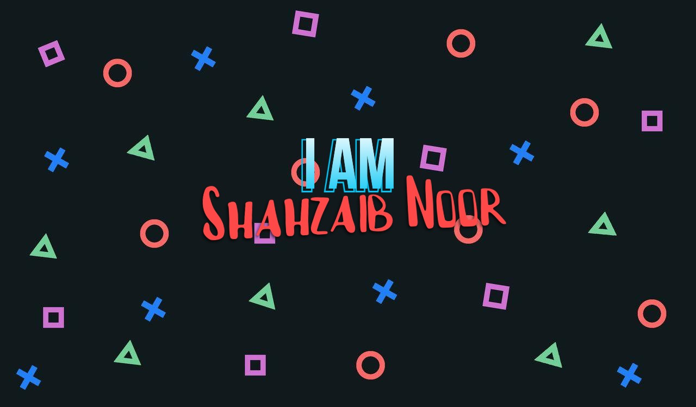

---

### Hi, I'm Shahzaib 👋

**Senior AI Engineer** working in **forward-deployed mode**: embedded
with client teams to take agentic AI and RAG systems from discovery
to production, and to keep them running.

I build systems that ship, not demos.

10 years of software engineering, 5 in AI/ML (3 delivering production
generative AI and agentic systems), across FinTech, Healthcare, IoT,
and SaaS.

---

### 🤝 How I Work: Forward Deployed

- Embedded with the client's team, working directly with the people who use the system
- Discovery first: find the real workflow problem before choosing an architecture
- One engineer owns it from first scoping call through production operation
- Evaluation, tracing and access controls in place before each release
- Decisions and trade-offs written down, so the client's team can run it after me

---

### 🧠 What I Build

- **Agentic AI Systems** — LangGraph, OpenAI Agents SDK,
  Model Context Protocol (MCP) tool integrations,
  multi-agent workflows

- **Production RAG Pipelines** — FAISS, Pinecone, pgvector,
  hybrid retrieval, reranking, document processing

- **LLM Engineering** — OpenAI, Anthropic, Azure OpenAI and Gemini
  integrations, structured outputs, evaluation and tracing
  (Langfuse, LangSmith)

- **AI-Assisted Development** — Claude Code, Codex and Cursor,
  plan-first workflow, CLAUDE.md / AGENTS.md context files

- **Backend & Distributed Systems** — Python, FastAPI, Django,
  Node.js, TypeScript, Kafka, Redis, Celery, async pipelines,
  event-driven architecture

- **Full-Stack Delivery** — React, Next.js, TypeScript,
  WebSocket dashboards, real-time interfaces

- **Cloud & DevOps** — AWS, Azure, GCP, Docker, Kubernetes,
  GitHub Actions, CI/CD, tracing and alerting

---

### 🛠️ Core Stack

---

### 🚀 Featured Projects

#### 🏥 CareCopilot AI — Multi-Agent Healthcare Platform
Client-delivered production platform used by clinicians. I owned it
from discovery through production operation. Agents interpret a request,
plan, call tools through MCP, and validate results, with evaluation
and tracing before each release.
**Average case review time cut from 4 hours to 32 minutes.**
`LangGraph` `OpenAI Agents SDK` `MCP` `Python` `Kafka` `PostgreSQL`

---

#### 📄 DocuSummarizer Pro — Agentic Document Intelligence
RAG pipelines for legal, finance, and research teams: hybrid
retrieval, evaluation harnesses, and reusable delivery patterns.
`LangGraph` `LangChain` `FAISS` `Pinecone` `Celery` `Redis`

---

#### 📡 Unified AV & IoT Monitoring — Real-Time Intelligence
Contract work (client confidential) on a flagship monitoring platform
for more than two years: a real-time event pipeline processing
thousands of IoT events per minute, with AI-assisted anomaly
detection and LLM-powered diagnostics.
`Kafka` `Python` `Node.js` `Redis` `Elasticsearch` `WebSockets` `Docker`

---

### 🔓 Open Source

- [prod-rag-system](https://github.com/ShahzaibSE/prod-rag-system) —
  backend-first RAG service: async ingestion with idempotency keys,
  a Redis job queue with retries and leases, 21 test files.
  Not deployed to production.
- [ai-coding-golden-paths](https://github.com/ShahzaibSE/ai-coding-golden-paths) —
  generator that renders engineering standards into Claude Code and
  Codex configuration (v0.1, early).
- [dashboard-payroll](https://github.com/ShahzaibSE/dashboard-payroll) —
  PayrollOps, a React and TypeScript operations dashboard pilot on
  synthetic data, with 419 tests.

---

### 📝 Technical Writing

- [How to Calculate Convolutional Parameters in CNNs](https://medium.com/@shahzaibnoor40/the-convolution-parameters-calculation-b2394da8dd59)
- [What is Tree Shaking in Angular?](https://medium.com/@shahzaibnoor40/this-is-a-new-and-exciting-day-as-angular-enthusiast-because-angular-9-has-been-released-with-ivy-6abb1e3cbfa0)

---

### 💬 Get in Touch

I'm open to remote roles and contract engagements, and to
relocation for the right role.

📧 shahzaibnoor40@gmail.com

🔗 [linkedin.com/in/shahzaib-noor-0a1b71b4](https://www.linkedin.com/in/shahzaib-noor-0a1b71b4/)

---

> *"The best code is the code that ships, runs reliably,
> and solves a real problem."*